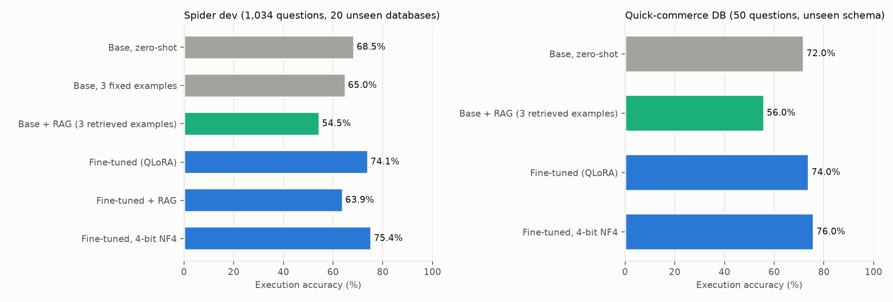
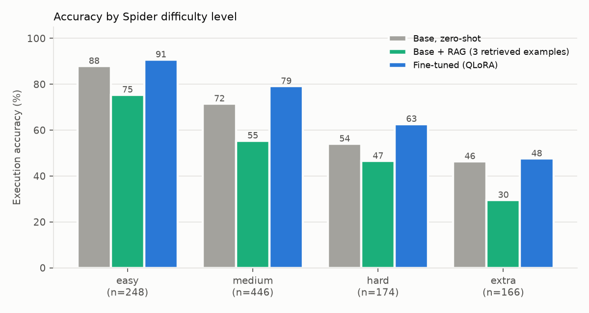
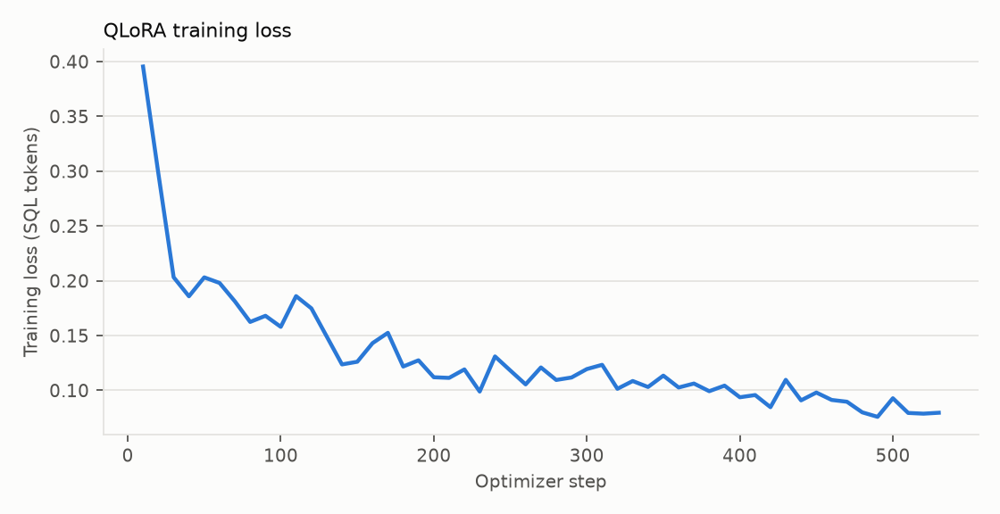
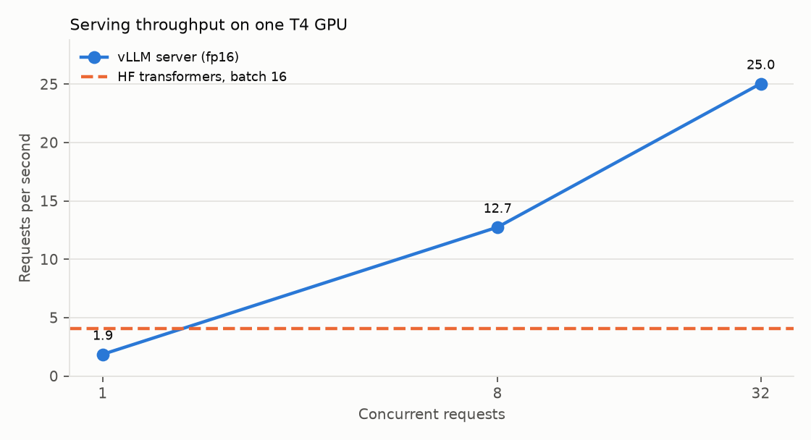
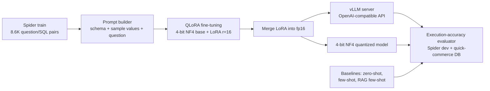

# InstaQuery: Fine-tuning a Small Open LLM for Text-to-SQL (QLoRA → vLLM)

[](https://colab.research.google.com/github/tarubee19/instaquery/blob/main/notebooks/InstaQuery_Colab.ipynb)
[](https://github.com/tarubee19/instaquery/actions/workflows/ci.yml)


**Ask a database a question in plain English and get the SQL.** InstaQuery fine-tunes
`Qwen/Qwen2.5-Coder-1.5B-Instruct` with **QLoRA** on the Spider benchmark, measures it with
**execution accuracy** against zero-shot, few-shot and **retrieval-augmented (RAG)** baselines,
quantizes it to **4-bit**, and serves it with **vLLM** behind an OpenAI-compatible API.
Everything runs on **one free Colab T4 GPU**.

> **Spider dev execution accuracy: 68.5% → 74.1%** after QLoRA fine-tuning (+5.6 pts) on 1,034 questions over databases never seen in training.

## Results

All numbers below were produced by `notebooks/InstaQuery_Colab.ipynb` (run mode: `full`, GPU: Tesla T4).

| Dataset | Variant | Execution accuracy | Valid SQL | Examples | Gen. time |
|---|---|---|---|---|---|
| Spider dev (1,034) | Base, zero-shot | **68.5%** | 85.6% | 1034 | 39s |
| Spider dev (1,034) | Base, 3 fixed examples | **65.0%** | 83.1% | 1034 | 40s |
| Spider dev (1,034) | Base + RAG (3 retrieved examples) | **54.5%** | 70.0% | 1034 | 76s |
| Spider dev (1,034) | Fine-tuned (QLoRA) | **74.1%** | 92.5% | 1034 | 40s |
| Spider dev (1,034) | Fine-tuned + RAG | **63.9%** | 78.7% | 1034 | 74s |
| Spider dev (1,034) | Fine-tuned, 4-bit NF4 | **75.4%** | 93.2% | 1034 | 325s |
| Quick-commerce (50) | Base, zero-shot | **72.0%** | 88.0% | 50 | 5s |
| Quick-commerce (50) | Base + RAG (3 retrieved examples) | **56.0%** | 70.0% | 50 | 7s |
| Quick-commerce (50) | Fine-tuned (QLoRA) | **74.0%** | 88.0% | 50 | 4s |
| Quick-commerce (50) | Fine-tuned, 4-bit NF4 | **76.0%** | 92.0% | 50 | 25s |





| Training | |
|---|---|
| Training examples | 8,577 (5.59M tokens) |
| Trainable parameters | 18.5M of 1562M (1.18%) |
| Steps / epochs | 537 / 1.0 |
| Training time | 105 min on Tesla T4 (resumed once from the step-100 checkpoint after a Colab disconnect) |
| Peak GPU memory | 5.2 GB |
| Final training loss | 0.110 |
| Official exact-set-match, Base, zero-shot | 42.6% |
| Official exact-set-match, Fine-tuned (QLoRA) | 63.3% |



### Serving (vLLM vs Hugging Face generate, same GPU)

| Setup | Requests/s | Output tokens/s | p50 latency |
|---|---|---|---|
| HF generate, 1 request at a time | 1.51 | - | 0.59s |
| HF generate, batch 16 | 4.09 | 117 | - |
| vLLM, concurrency 1 | 1.86 | 53 | 0.40s |
| vLLM, concurrency 8 | 12.75 | 366 | 0.47s |
| vLLM, concurrency 32 | 25.04 | 717 | 0.77s |



### What fine-tuning changed (spider_dev)

* Questions the base model got wrong and the fine-tuned model got right: **124**
* Questions the base model got right and the fine-tuned model got wrong: **66**

| Error type | Base, zero-shot | Fine-tuned (QLoRA) |
|---|---|---|
| unknown column | 140 | 73 |
| wrong result (row count) | 104 | 103 |
| wrong result (values) | 73 | 87 |
| other execution error | 5 | 4 |
| unknown table | 4 | 1 |

Examples fixed by fine-tuning:

* **Q:** Show the name and the release year of the song by the youngest singer.  
  base: `SELECT T2.Song_Name, T2.Song_release_year FROM singer AS T1 INNER JOIN singer_in_concert AS T2 ON T1.Singer_ID = T2.Singer_ID ORDER BY T1.Age ASC LIMIT 1` (unknown column)  
  fine-tuned: `SELECT song_name , song_release_year FROM singer ORDER BY age LIMIT 1`
* **Q:** What are the names and release years for all the songs of the youngest singer?  
  base: `SELECT T2.Song_Name, T2.Song_release_year FROM singer AS T1 INNER JOIN singer_in_concert AS T2 ON T1.Singer_ID = T2.Singer_ID ORDER BY T1.Age ASC LIMIT 1` (unknown column)  
  fine-tuned: `SELECT song_name , song_release_year FROM singer ORDER BY age LIMIT 1`
* **Q:** List all song names by singers above the average age.  
  base: `SELECT T2.song_name FROM singer AS T1 INNER JOIN singer_in_concert AS T2 ON T1.singer_id = T2.singer_id WHERE T1.age > (SELECT AVG(age) FROM singer)` (unknown column)  
  fine-tuned: `SELECT song_name FROM singer WHERE age > (SELECT avg(age) FROM singer)`
* **Q:** Show countries where a singer above age 40 and a singer below 30 are from.  
  base: `SELECT DISTINCT T2.Country FROM singer AS T1 INNER JOIN singer_in_concert AS T2 ON T1.Singer_ID = T2.Singer_ID WHERE T1.Age > 40 INTERSECT SELECT DISTINCT T2.Country FROM singer AS T1 INNER JOIN singer_in_concert AS T2 O` (unknown column)  
  fine-tuned: `SELECT country FROM singer WHERE age > 40 INTERSECT SELECT country FROM singer WHERE age < 30`
* **Q:** what is the name and nation of the singer who have a song having 'Hey' in its name?  
  base: `SELECT T1.Name, T1.Country FROM singer AS T1 INNER JOIN singer_in_concert AS T2 ON T1.Singer_ID = T2.Singer_ID INNER JOIN concert AS T3 ON T2.concert_ID = T3.concert_ID WHERE T3.Theme LIKE '%Hey%'` (wrong result (row count))  
  fine-tuned: `SELECT name , country FROM singer WHERE song_name LIKE "%Hey%"`

## Key findings

1. **QLoRA fine-tuning gives a significant gain on unseen databases.** Spider dev execution accuracy rose from
   **68.5% to 74.1%** (95% CI 65.6–71.2% → 71.3–76.7%). Fine-tuning fixed 124 questions and broke 66
   (McNemar χ² = 17.1, **p < 0.0001**). Official exact-set-match rose much more (**42.6% → 63.3%**),
   because the model learned Spider's SQL conventions, not just correct answers.
2. **The gain comes from fewer schema hallucinations.** "Unknown column" errors halved (140 → 73), and
   the valid-SQL rate rose from 85.6% to 92.5%. The improvement is largest on *medium* (71.5 → 79.1%) and
   *hard* (54.0 → 62.6%) questions.
3. **Naive RAG hurts small models.** Adding the three most similar training questions from *other*
   databases dropped accuracy by 14 pts (68.5 → 54.5%). The model copied table and column names from the examples:
   "unknown table" errors went from 4 to 92. Retrieved examples need to be schema-aware (or from the same database).
4. **4-bit NF4 quantization is free here.** The quantized model scored 75.4% in 1.12 GB of GPU memory,
   vs 74.1% for fp16 in 3.09 GB (2.8× smaller). The gap is within noise; the two variants also use different decoders.
5. **vLLM serves 6× more traffic.** At 32 concurrent requests the model served 25.0 req/s (717 output tokens/s)
   vs 4.1 req/s for batched Hugging Face `generate` on the same T4. Single-request p50 latency fell from 0.59 s to 0.40 s.
6. **Transfer to a business schema is modest.** On the 50-question quick-commerce database the fine-tuned model
   scored 74% (base 72%, NF4 76%). With n = 50 the difference is not significant. Hard multi-join / date questions
   remain at 33–40%, so domain examples would be the next lever.


## How it works



1. **Data.** [Spider 1.0](https://yale-lily.github.io/spider): 8,659 training questions over 146 databases and
   1,034 dev questions over 20 *different* databases, so the dev score measures generalisation to unseen schemas.
   A second test set is a synthetic **quick-commerce** SQLite database (dark stores, orders, inventory,
   delivery partners; 7 tables, 25K orders) with 50 hand-written, execution-verified business questions.
2. **Prompt.** The schema is serialised as `CREATE TABLE` statements with primary/foreign keys and three sample
   values per text column (so the model can match literals). Very large schemas drop the sample values.
3. **Baselines.** Same base model with (a) zero-shot prompting, (b) three fixed examples, and
   (c) **RAG**: the three most similar training questions retrieved with dense embeddings
   (`BAAI/bge-small-en-v1.5`), never from the same database.
4. **QLoRA.** Base weights frozen in 4-bit NF4 with double quantisation; LoRA adapters (r=16, α=32, dropout 0.05)
   on all attention and MLP projections; loss only on SQL tokens; cosine LR 2e-4, effective batch 16, 1 epoch,
   paged 8-bit AdamW, gradient checkpointing.
5. **Evaluation.** A prediction is correct if it returns the same result as the gold query when executed
   (bag semantics, order-sensitive only with `ORDER BY`, column permutations allowed), following the official
   Spider test-suite evaluator. Queries run read-only with a hard timeout. Difficulty labels and exact-set-match
   come from the official evaluator.
6. **Serving.** The LoRA weights are merged into an fp16 model, served with vLLM (continuous batching,
   PagedAttention), and benchmarked at different concurrency levels against Hugging Face `generate`.
7. **Quantisation.** The merged model is reloaded in 4-bit NF4 to measure the accuracy/memory trade-off.
8. **Demo.** A Gradio app turns questions into SQL for the quick-commerce database, with guardrails
   (sqlglot parse, single read-only `SELECT`, read-only connection, timeout, row cap).

## Engineering notes (problems hit and how they were solved)

| Problem | Root cause | Fix |
|---|---|---|
| vLLM failed to start on the T4 | No FlashAttention-2 on sm75, so vLLM picked FlashInfer, which JIT-compiles kernels (`ninja` not on PATH) | `--attention-backend TRITON_ATTN` (no compilation step) |
| Out-of-memory during training (3.8 GB allocation) | Qwen's 152K-token vocabulary: full-sequence logits for a 4×2048 batch need ~5 GB in fp32 | Left-pad batches and compute logits only for the answer tokens (`logits_to_keep`); peak memory 5.2 GB |
| Training slower than needed | Random batches padded to the longest sequence (60% padding) | Length-grouped sampler (8% padding), about 1.4× faster |
| **Fine-tuned model scored 15 pts *below* the base model when served by vLLM** | transformers 5 saved `rope_theta` inside `rope_parameters`; the older transformers inside vLLM silently fell back to the default RoPE base (10,000 instead of 1,000,000) | Ship the base model's `config.json` with the merged weights. Caught because the 4-bit HF evaluation of the *same* weights scored 75% (a parity check between serving paths) |
| Merged model was identical to the base model (first attempt) | Copying tokenizer files from the Hugging Face cache snapshot also copied the base weights | Copy files by pattern only, plus a `verify_merge` check that fails if the LoRA delta is zero |
| Colab runtime recycled mid-training | Free-tier runtime disconnected at step ~92 | Checkpoints every 100 steps to Google Drive; the run resumed from step 100 |
| `TrainingArguments(warmup_ratio=...)` crashed | Argument removed in transformers 5 | Filter arguments against the installed version's dataclass fields |


## Reproduce

Click the **Open in Colab** badge (or open `notebooks/InstaQuery_Colab.ipynb`), choose **Runtime → Change runtime type → T4 GPU**,
set `RUN_MODE = "quick"` for a 20-minute smoke test or `"full"` for the complete run, then **Run all**.
Outputs (metrics, predictions, charts, LoRA adapter) are saved to Google Drive.

```bash
pip install -r requirements.txt
pytest -q            # unit tests for evaluator, prompts, schema, guardrails, domain DB
python app/gradio_app.py --model <merged_model_dir> --db quickcommerce.sqlite
```

## Repository layout

```
src/instaquery/
  spider_data.py   download + load Spider
  schema.py        SQLite schema -> prompt text (keys, sample values)
  prompts.py       chat prompts, SQL extraction/normalisation
  retrieval.py     dense / TF-IDF retrieval of similar examples (RAG few-shot)
  train.py         QLoRA fine-tuning + LoRA merge
  generation.py    batched HF generation and async OpenAI-compatible client
  serving.py       vLLM server in an isolated venv
  sql_eval.py      execution accuracy with timeouts, error taxonomy
  official_eval.py official Spider difficulty + exact-match
  domain_db.py     synthetic quick-commerce database
  safety.py        SQL guardrails for the demo
  pipeline.py      cached evaluation runs and benchmarks
  report.py        tables, charts, README, CV summary
data/quickcommerce_eval.json   50 business questions with verified gold SQL
notebooks/InstaQuery_Colab.ipynb  end-to-end Colab notebook (T4 GPU)
results/                       metrics, benchmark, training stats from the full run
assets/                        charts used in this README
app/gradio_app.py              demo UI
tests/                         pytest suite (runs in CI)
```

## Limitations

* Spider dev is a public benchmark; scores are not comparable to the hidden Spider test leaderboard.
* The quick-commerce set has 50 questions, so its numbers have wide confidence intervals (±7 pts at 95%).
* The quick-commerce database is synthetic (fictional brands and people).
* Exact-set-match is reported for reference only; execution accuracy is the main metric.

## References

Yu et al., *Spider* (EMNLP 2018) · Zhong et al., *Semantic Evaluation for Text-to-SQL with Distilled Test Suites* (EMNLP 2020) ·
Hu et al., *LoRA* (2021) · Dettmers et al., *QLoRA* (2023) · Kwon et al., *vLLM / PagedAttention* (SOSP 2023) ·
Hui et al., *Qwen2.5-Coder Technical Report* (2024).
